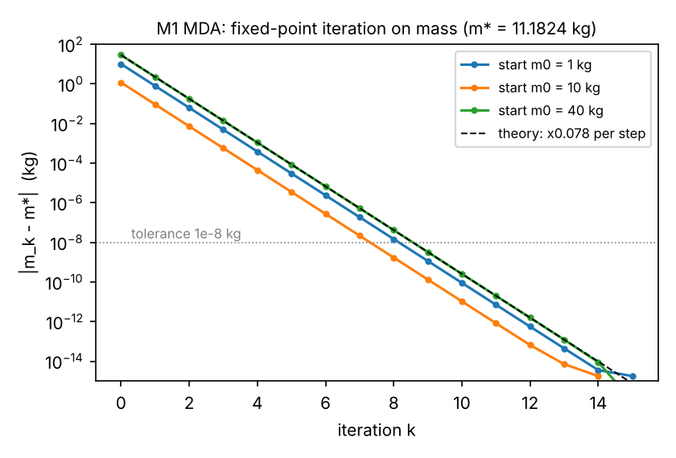
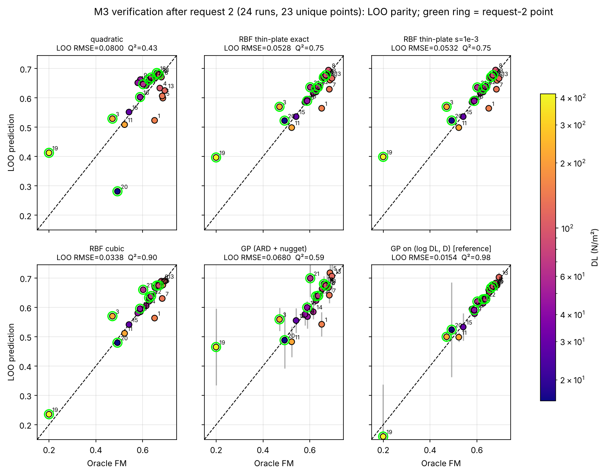

# Verification appendix

One figure or table per module. Figures and tables are written by `python run_all.py`
into `figures/` and `results/`.

| Module | Check required by the brief | Evidence | Status |
|---|---|---|---|
| M0 | Formulation card review (no code check) | — | ⬜ |
| M1 | MDA convergence plot; finite-difference gradient check at two step sizes; MDF vs IDF within 1% | `figures/m1_mda_convergence.png`, `figures/m1_gradient_check.png`, `results/m1_gradient_check.csv`, `results/m1_mdf_vs_idf.csv`, `results/m1_hand_check.csv` | ✅ |
| M2 | MBB-beam benchmark reproduced; no-filter and p = 1 cases explained | — | ⬜ |
| M3 | LOOCV error table; parity plot; note on oracle noise | `results/m3_loo_table.csv`, `figures/m3_loo_parity.png`, `figures/m3_loo_parity_24pts.png` | 🟡 requests 1+2 |
| M4 | Brute force on 4-hub, 8-PHC sub-instance matches solver; LP-relaxation gap; big-M justified | — | ⬜ |
| M5 | One hub, exponential service, no wind/outage vs Erlang C; days chosen so S45 95% CI < ±3 pp | — | ⬜ |
| M6 | Weighted-sum points on or behind NSGA-II front (2-objective slice); re-simulated front vs surrogate | — | ⬜ |
| M7 | Robustness / reliability / sensitivity tables | — | ⬜ |

## M1 — Vehicle MDO

**MDA convergence.** Fixed-point iteration on mass from 1, 10 and 40 kg. The error falls by 0.078 per step
(the slope of eq. 1 in m), as predicted, and reaches 1e-8 kg in 8–10 iterations.

**Analysis hand check.** A line-by-line `math` re-implementation of eqs. (1)–(6), with the mass equation solved in
closed form, matches the code to a relative error of 1e-14 on all 5 designs. It also matches the partner's max-radius
design (20.149 kg, R = 27.27 km, not 29.49 km). See `results/m1_hand_check.csv`.

**Gradient check** (`results/m1_gradient_check.csv`). The optimiser uses complex-step gradients. Max relative error of finite differences against them:

| point | function | forward 1e-4 | forward 1e-6 | central 1e-4 | central 1e-6 |
|---|---|---|---|---|---|
| baseline optimum | objective m | 2.5e-5 | 2.5e-7 | 2.5e-10 | 1.6e-9 |
| baseline optimum | constraints | 1.1e-2 | 1.1e-4 | 8.0e-7 | 2.3e-8 |
| random point | objective m | 3.3e-5 | 3.2e-7 | 4.3e-10 | 1.5e-9 |
| random point | constraints | 2.5e-4 | 2.5e-6 | 5.0e-8 | 3.7e-9 |

Forward-difference error falls 100× when h falls 100× (truncation, O(h)), and central differences are O(h²) until
round-off. The step sweep below shows the classic V, with the minimum near h = 1e-7. Loosening the MDA tolerance from 1e-12
to 1e-8 barely changes this: the iterates are smooth in x because the iteration count does not change between x and x + h.

**MDF vs IDF** (`results/m1_mdf_vs_idf.csv`). 8 starts each, and all 8 converge to the same optimum for every design:

| design | R_req km | m MDF kg | m IDF kg | difference |
|---|---|---|---|---|
| A light | 10.0 | 6.6170 | 6.6170 | < 1e-9 % |
| B all-but-one | 14.6 | 7.9892 | 7.9892 | < 1e-9 % |
| C cover-all | 18.4 | 9.5938 | 9.5938 | < 1e-9 % |
| D 4-hub | 19.7 | 10.2746 | 10.2746 | < 1e-9 % |
| E 3-hub | 24.0 | 13.7111 | 13.7111 | < 1e-9 % |

**Multiplier check.** The KKT payload multiplier is 0.380 km per 100 g; a direct re-solve gives 0.381 km.
dm*/dm_pay is 1.870 (re-solve 1.871), and dm*/dR is 0.492 kg/km (re-solve 0.494).

**Snapped designs re-checked.** Every constraint was re-run with catalogue masses and the chosen motor's rating. All 5 are feasible
(`results/m1_designs.csv`, columns `g: ...`).

## M3 — Rotor surrogate

LOOCV table: `results/m3_loo_table.csv` (each fold refits the model from scratch, GP hyperparameters included).

After request 2 (23 unique points): 
Table: `results/m3_loo_table_24pts.csv` (also `results/m3_loo_table.csv` from `run_all.py`). Headline metric RMSE (Q² secondary, inflated by the FM 0.20 point). Overfitting checks: repeated 5-fold CV `results/m3_cv_5fold_24pts.csv`; hold-out (fit on request 1, test on 8 request-2 points) `results/m3_holdout_request2.csv`: RBF cubic RMSE 0.024, GP 0.127; model surfaces `figures/m3_model_surfaces_24pts.png`.

Noise note (draft, rewrite in own words): one repeat (pt 3: 0.4683 vs 0.4730) gives σ_noise ≈ 0.003, about 10× below the LOO errors, so the oracle is treated as near-noise-free. The GP's fitted nugget (≈1e-6 relative) agrees. Repeated runs are averaged before fitting and cross-validation.
