# Verification appendix

One figure or table per module. Figures and tables are written by `python run_all.py`
into `figures/` and `results/`.

| Module | Check required by the brief | Evidence | Status |
|---|---|---|---|
| M0 | Formulation card review; data audit backing the card's numbers | `figures/m0_decision_hierarchy.png`, `results/m0_data_checks.csv`, `results/m0_framing_numbers.csv` | ✅ |
| M1 | MDA convergence plot; finite-difference gradient check at two step sizes; MDF vs IDF within 1% | `figures/m1_mda_convergence.png`, `figures/m1_gradient_check.png`, `results/m1_gradient_check.csv`, `results/m1_mdf_vs_idf.csv`, `results/m1_hand_check.csv` | ✅ |
| M2 | MBB-beam benchmark reproduced; no-filter and p = 1 cases explained | `figures/m2_mbb_benchmark.png`, `results/m2_mbb_benchmark.csv`, `results/m2_verification.csv` | ✅ |
| M3 | LOOCV error table; parity plot; note on oracle noise | `results/m3_final_error_table.csv`, `figures/m3_loo_parity_final.png`, noise note below | ✅ final (30 runs) |
| M4 | Brute force on 4-hub, 8-PHC sub-instance matches solver; LP-relaxation gap; big-M justified | `results/m4_bruteforce.csv`, `results/m4_lp_gap.csv`, `results/m4_bigm_check.csv`, `results/m4_hand_check.csv`, `figures/m4_networks.png` | ✅ |
| M5 | One hub, exponential service, no wind/outage vs Erlang C; days chosen so S45 95% CI < ±3 pp | `figures/m5_mmc_check.png`, `results/m5_mmc_check.csv`, `figures/m5_s45_days.png`, `results/m5_days_ci.csv`, `results/m5_hand_check.csv`, `results/m5_rule_checks.csv` | ✅ |
| M6 | Weighted-sum points on or behind NSGA-II front (2-objective slice); re-simulated front vs surrogate | — | ⬜ |
| M7 | Robustness / reliability / sensitivity tables | — | ⬜ |

## M0 — Problem framing

The brief asks for no code check in M0. To make sure the card's numbers come from the data, `run_all.py` audits
every file (`results/m0_data_checks.csv`, 18 checks). Two are flagged and handled: the routine hourly fractions sum to
1.1993 (rescaled to 1 for M5), and the catalogue has 28 tubes, not 30. The numbers quoted on the card (demand per day,
₹5.57 crore road-only cost, 2 bays in an outage, ₹15.1 lakh minimum staff per hub) are in `results/m0_framing_numbers.csv`.

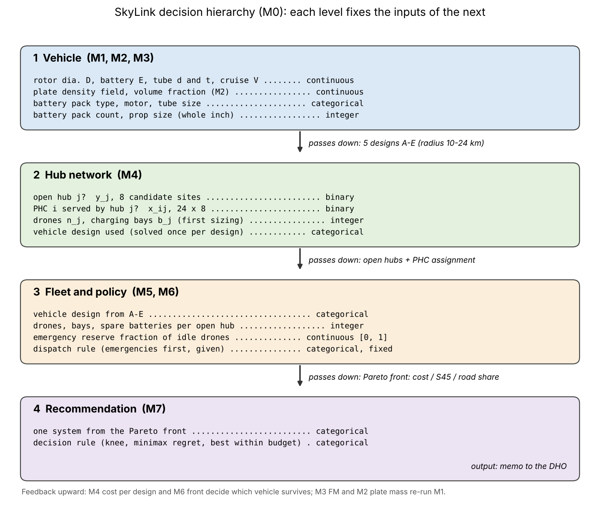

## M1 — Vehicle MDO

**MDA convergence.** Fixed-point iteration on mass from 1, 10 and 40 kg. The error falls by 0.078 per step
(the slope of eq. 1 in m), as predicted, and reaches 1e-8 kg in 8–10 iterations.

**Analysis hand check.** A line-by-line `math` re-implementation of eqs. (1)–(6), with the mass equation solved in
closed form, matches the code to a relative error of 1e-14 on all 5 designs. It also matches the partner's max-radius
design (20.149 kg, R = 27.27 km, not 29.49 km). See `results/m1_hand_check.csv`.

**Gradient check** (`results/m1_gradient_check.csv`). The optimiser uses complex-step gradients. Max relative error of finite differences against them:

| point | function | forward 1e-4 | forward 1e-6 | central 1e-4 | central 1e-6 |
|---|---|---|---|---|---|
| baseline optimum | objective m | 2.5e-5 | 2.5e-7 | 2.5e-10 | 1.6e-9 |
| baseline optimum | constraints | 1.1e-2 | 1.1e-4 | 8.0e-7 | 2.3e-8 |
| random point | objective m | 3.3e-5 | 3.2e-7 | 4.3e-10 | 1.5e-9 |
| random point | constraints | 2.5e-4 | 2.5e-6 | 5.0e-8 | 3.7e-9 |

Forward-difference error falls 100× when h falls 100× (truncation, O(h)), and central differences are O(h²) until
round-off. The step sweep below shows the classic V, with the minimum near h = 1e-7. Loosening the MDA tolerance from 1e-12
to 1e-8 barely changes this: the iterates are smooth in x because the iteration count does not change between x and x + h.

**MDF vs IDF** (`results/m1_mdf_vs_idf.csv`). 8 starts each, and all 8 converge to the same optimum for every design:

| design | R_req km | m MDF kg | m IDF kg | difference |
|---|---|---|---|---|
| A light | 10.0 | 6.6170 | 6.6170 | < 1e-9 % |
| B all-but-one | 14.6 | 7.9892 | 7.9892 | < 1e-9 % |
| C cover-all | 18.4 | 9.5938 | 9.5938 | < 1e-9 % |
| D 4-hub | 19.7 | 10.2746 | 10.2746 | < 1e-9 % |
| E 3-hub | 24.0 | 13.7111 | 13.7111 | < 1e-9 % |

**Multiplier check.** The KKT payload multiplier is 0.380 km per 100 g; a direct re-solve gives 0.381 km.
dm*/dm_pay is 1.870 (re-solve 1.871), and dm*/dR is 0.492 kg/km (re-solve 0.494).

**Snapped designs re-checked.** Every constraint was re-run with catalogue masses and the chosen motor's rating. All 5 are feasible
(`results/m1_designs.csv`, columns `g: ...`).

## M2 — Hub plate topology

**MBB-beam benchmark** (top88 inputs: 60 × 20 half-beam, vf 0.5, r_min 1.5, same SIMP/OC code as the plate, with a Q4 plane-stress element). `results/m2_mbb_benchmark.csv`.

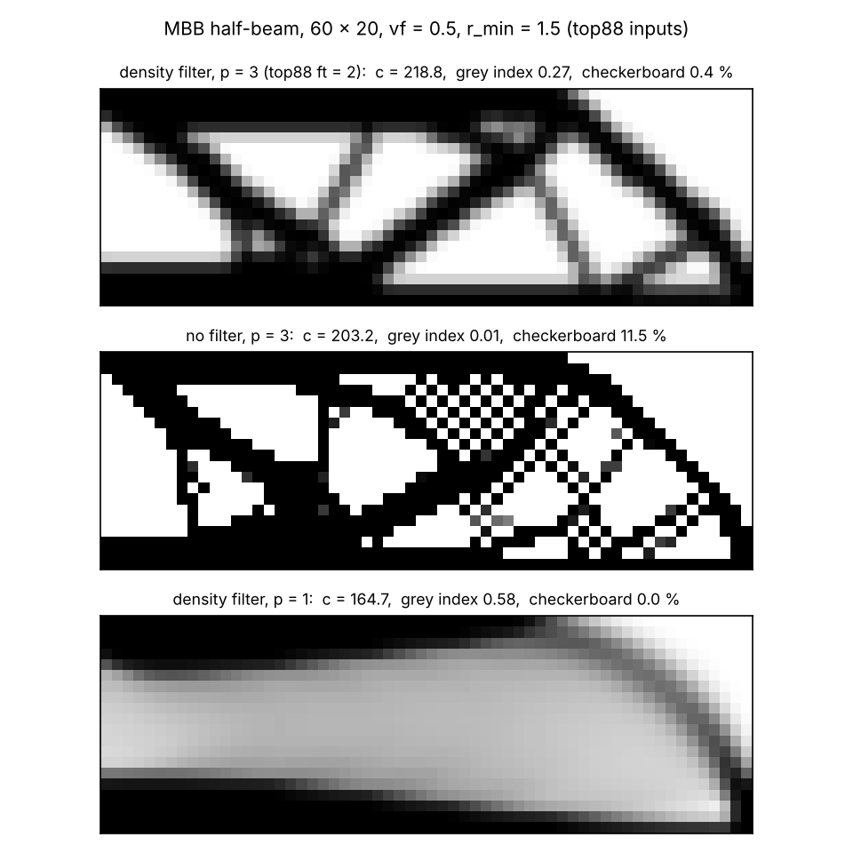

| case | compliance | grey index | checkerboard 2×2 patches | compliance of that layout re-evaluated with p = 3 |
|---|---|---|---|---|
| density filter, p = 3 | 218.8 | 0.27 | 0.4 % | 218.8 |
| no filter, p = 3 | 203.2 | 0.01 | 11.5 % | 203.2 |
| density filter, p = 1 | 164.7 | 0.58 | 0 % | 425.3 |

Explanation (draft, rewrite in own words):
- **No filter.** The design breaks into checkerboards. Bilinear Q4 elements joined only at corners are artificially stiff, so the optimiser exploits a numerical error. The lower compliance (203 vs 219) is not real, and the layout changes with the mesh. The filter imposes a length scale (r_min) and removes this.
- **p = 1.** There is no penalty on intermediate density, so the problem becomes a convex variable-thickness sheet, and grey material is as efficient per unit volume as solid. The optimum is mostly grey (grey index 0.58), which cannot be cut from one plate. Its low compliance is only possible because grey is allowed: the same layout re-evaluated with p = 3 has compliance 425, twice that of the p = 3 design. p = 3 makes grey uneconomical and pushes densities to 0/1.

**Plate model and optimiser checks** (`results/m2_verification.csv`):

| check | result |
|---|---|
| ACM plate element: simply supported square plate, uniform load, w_max·D/(q a⁴) vs Navier 0.004062 | 8²: +1.6 %, 16²: +0.41 %, 32²: +0.10 %, 64²: +0.026 % (converges) |
| Quarter model ×4 vs whole plate, solid plate compliance | identical (rel. diff. < 1e-9) |
| Adjoint dc/dx through the density filter vs central differences (6 elements) | max rel. error 1e-6 (step 1e-4), 3e-5 (step 1e-6) |
| Mesh: cut-part compliance ratio at vf 0.32, designed on 2 mm vs 1.33 mm mesh | 2.31 vs 2.33 (−0.6 %) → design to 2.4 for margin |
| 6 mm minimum member: opening the final outline with a 6 mm disk removes | 0.0 mm²; narrowest member measured 6.75 mm |

**Sweep and chosen design** (`results/m2_sweep.csv`, `results/m2_design.csv`, `figures/m2_compliance_vs_mass.png`, `figures/m2_outline.png`, `figures/m2_topologies.png`). Chosen: vf 0.32, cut part 108.7 g, 2.31 × solid compliance, w_max 0.73 mm, peak bending stress 107 MPa (yield 276 MPa) at 2 g with the heaviest battery (186 N).

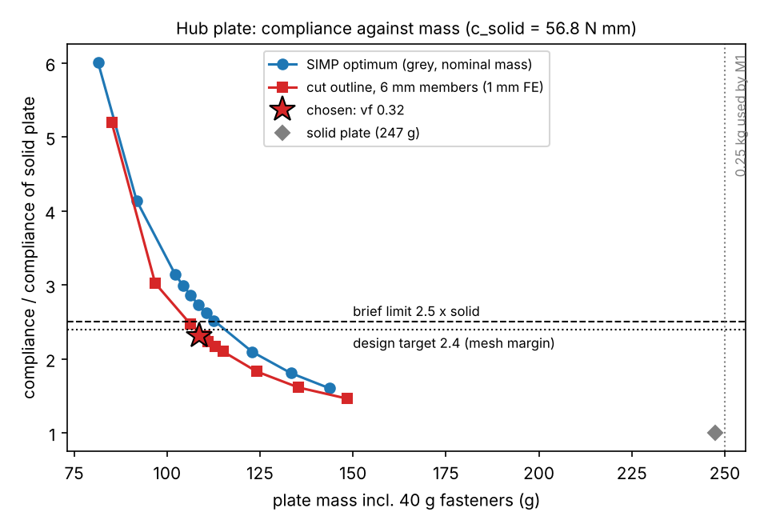
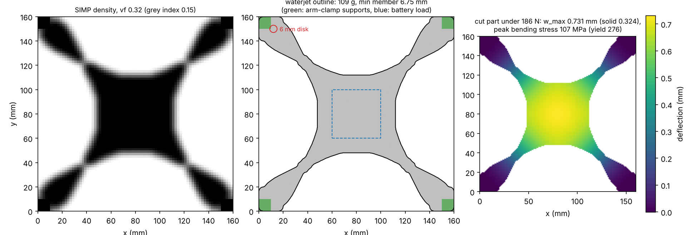

**M1 re-run with the M2 plate (0.25 → 0.109 kg)**, `results/m2_m1_feedback.csv`:

| design | FM0 continuous kg | FM0 snapped kg | surrogate FM continuous kg | surrogate FM snapped kg |
|---|---|---|---|---|
| A | 6.617 → 6.388 (−229 g) | 7.220 → 6.773 (−447 g) | 6.890 → 6.658 (−232 g) | 7.251 → 7.081 (−170 g) |
| B | 7.989 → 7.708 (−282 g) | 8.395 → 8.215 (−180 g) | 8.525 → 8.273 (−252 g) | 8.675 → 8.495 (−180 g) |
| C | 9.594 → 9.259 (−334 g) | 10.400 → 10.209 (−192 g) | 10.334 → 10.022 (−312 g) | 10.921 → 10.732 (−189 g) |
| D | 10.275 → 9.916 (−359 g) | 11.020 → 10.829 (−192 g) | 11.128 → 10.793 (−335 g) | 11.782 → 11.641 (−141 g) |
| E | 13.711 → 13.176 (−536 g) | 15.715 → 15.515 (−200 g) | 14.479 → 14.132 (−347 g) | 15.381 → 15.192 (−189 g) |

The continuous optima fall by 1.6–3.8 × the 141 g saved, because a lighter airframe needs a smaller battery and motors (the M1 mass snowball). From here on, every M1 output in `results/` and the M1 re-run inside M3 use the M2 plate.

## M3 — Rotor surrogate

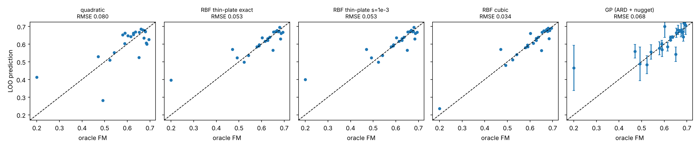

LOOCV table: `results/m3_loo_table.csv` (each fold refits the model from scratch, GP hyperparameters included).

After request 2 (23 unique points): 
Table: `results/m3_loo_table_24pts.csv` (also `results/m3_loo_table.csv` from `run_all.py`). Headline metric RMSE (Q² secondary, inflated by the FM 0.20 point). Overfitting checks: repeated 5-fold CV `results/m3_cv_5fold_24pts.csv`; hold-out (fit on request 1, test on 8 request-2 points) `results/m3_holdout_request2.csv`: RBF cubic RMSE 0.024, GP 0.127; model surfaces `figures/m3_model_surfaces_24pts.png`.

Noise note (draft, rewrite in own words): one repeat (pt 3: 0.4683 vs 0.4730) gives σ_noise ≈ 0.003, about 10× below the LOO errors, so the oracle is treated as near-noise-free. The GP's fitted nugget (≈1e-6 relative) agrees. Repeated runs are averaged before fitting and cross-validation.

### M1 re-run with the surrogate FM (cubic RBF)

`results/m1_fm_comparison.csv`, `results/m1_fm_hover_points.csv`, `figures/m1_fm_rerun.png`. Still air, same required radii as FM0. _The table below is with the provisional 0.25 kg plate. `run_all.py` now re-runs it with the M2 plate (0.109 kg), so the CSV holds the post-M2 values; see the M2 section for the change._

| design | R_req km | m FM0 → surr. kg | D FM0 → surr. m | E FM0 → surr. Wh | V FM0 → surr. m/s | T loaded / empty, surr. N | FM loaded / empty | FM0 design's R with real FM | snapped surr. kg |
|---|---|---|---|---|---|---|---|---|---|
| A | 10.0 | 6.62 → 6.89 (+4.1 %) | 0.655 → 0.524 | 259 → 330 | 13.8 → 15.5 | 16.9 / 10.8 | 0.653 / 0.600 | 8.7 km | 7.25 |
| B | 14.6 | 7.99 → 8.52 (+6.7 %) | 0.717 → 0.690 | 425 → 509 | 14.7 → 15.9 | 20.9 / 14.8 | 0.624 / 0.574 | 13.0 km | 8.68 |
| C | 18.4 | 9.59 → 10.33 (+7.7 %) | 0.785 → 0.686 | 605 → 756 | 15.7 → 17.3 | 25.3 / 19.2 | 0.645 / 0.613 | 16.3 km | 10.92 |
| D | 19.7 | 10.27 → 11.13 (+8.3 %) | 0.800 → 0.690 | 687 → 861 | 16.1 → 17.9 | 27.3 / 21.2 | 0.648 / 0.626 | 17.5 km | 11.78 |
| E | 24.0 | 13.71 → 14.48 (+5.6 %) | 0.800 → 0.755 | 1145 → 1277 | 18.7 → 19.6 | 35.5 / 29.4 | 0.663 / 0.633 | 22.9 km | 15.38 |

Checks:
- Every loaded and empty hover point, continuous and snapped, is inside 8–40 N and inside the convex hull of the oracle points (the hull constraints are inactive; the smallest slack is 0.054).
- GP σ at those points is 0.001–0.004.
- The GP mean used as FM gives the same masses to within 0.6 %.
- 20 multistarts reach one optimum.
- All 5 snapped designs pass every constraint.

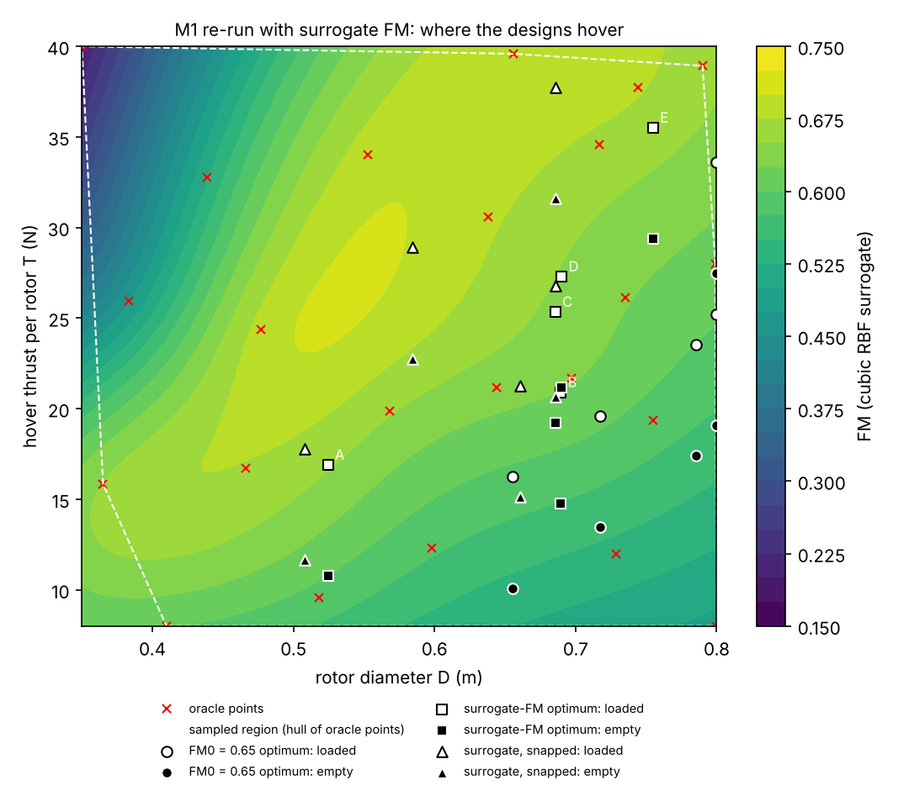

### Final verification (30 runs, 29 unique points) — `notebooks/M3_step8_final.ipynb`

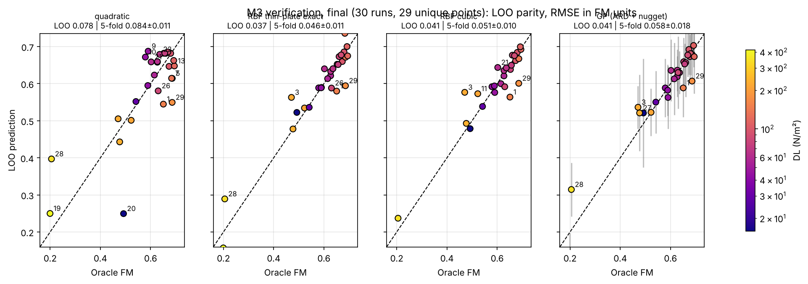

RMSE in FM units (`results/m3_final_error_table.csv`). The final hold-out is request 3, scored against predictions frozen before it was sent (`results/m3_holdout_request3.csv`):

| model | LOO RMSE | 5-fold RMSE (20 shuffles) | final hold-out RMSE (6 pts) | LOO Q² | mean z² |
|---|---|---|---|---|---|
| quadratic | 0.078 | 0.084 ± 0.011 | 0.088 | 0.61 | — |
| RBF thin-plate | 0.037 | 0.046 ± 0.011 | 0.059 | 0.91 | — |
| **RBF cubic (used)** | 0.041 | 0.051 ± 0.010 | 0.051 | 0.89 | — |
| GP (D, T) | 0.041 | 0.058 ± 0.018 | 0.044 | 0.89 | 13.9 |

Final surrogate with uncertainty (cubic RBF, jackknife std): 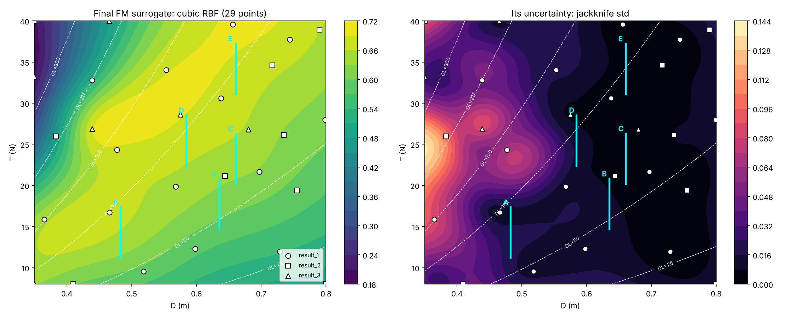

**Noise note (draft, rewrite in own words).** One repeated point (0.383 m, 25.97 N) returned 0.4683 and 0.4730, so the noise std is about 0.0047/√2 ≈ 0.003. That is roughly 15× smaller than the surrogate errors (RMSE 0.04–0.05), so the oracle is treated as practically deterministic. The models interpolate. The GP's fitted nugget stays near zero, which agrees. Repeated runs are averaged before fitting and before cross-validation. Caveat: this rests on one pair.

**What a smooth model handles badly (draft).** FM falls steeply at high disk loading. At small D it goes from 0.686 (DL 178) to 0.523 (DL 217), 0.471 (DL 225), 0.205 (DL 345) and 0.200 (DL 416).
- Every model's largest errors sit on this cliff and on the ridge just before it. In the final hold-out, R3-5 (DL 345, FM 0.205) and R3-6 (DL 178, FM 0.686, predicted about 0.59 by all models) were the worst points.
- The GP is badly over-confident there (mean z² 13.9). The cubic RBF shows a small wiggle along D ≈ 0.46 m between close points.
- How it was handled:
  - (1) Two request-3 points were spent on the cliff.
  - (2) M1 may only use FM inside the convex hull of the oracle points (FMDomain constraints).
  - (3) The M1 designs sit at DL 40–110, where the jackknife std of the surrogate is below about 0.02 and all models agree.
  - The cliff region is reported as untrustworthy for design and is not used.

### Local error where M1 operates (DL 40–110) — `results/m3_local_error_M1_region.csv`

| Model | LOO RMSE, DL 40–110 (n=16) | max abs LOO error | Hold-out RMSE at R3-1/R3-2 (near C, D) | Global LOO RMSE |
|---|---|---|---|---|
| Quadratic | 0.044 | 0.097 | 0.028 | 0.078 |
| RBF thin-plate | 0.016 | 0.042 | 0.006 | 0.037 |
| RBF cubic (used) | 0.017 | 0.042 | 0.007 | 0.041 |
| GP (ARD + nugget) | 0.013 | 0.034 | 0.002 | 0.041 |

The global error is driven by the cliff above DL ≈ 180, which M1 never uses. In the M1 band the cubic RBF error is
about 0.017 in FM (about 2–3 % of FM ≈ 0.65–0.75), and about 0.007 at the two hold-out points next to designs C and D.

### M1 optimum with the final surrogate (plate mass from M2) — `results/m3_m1_optimum_shift.csv`

| design | m FM0 kg | m 24-run fit kg | m final kg | Δ vs FM0 | Δ vs 24-run | D FM0 → final m |
|---|---|---|---|---|---|---|
| A | 6.39 | 6.66 | 6.64 | +4.0 % | −0.2 % | 0.646 → 0.533 |
| B | 7.71 | 8.27 | 8.27 | +7.3 % | 0.0 % | 0.711 → 0.691 |
| C | 9.26 | 10.02 | 9.99 | +7.9 % | −0.4 % | 0.779 → 0.684 |
| D | 9.92 | 10.79 | 10.73 | +8.2 % | −0.6 % | 0.800 → 0.685 |
| E | 13.18 | 14.13 | 14.13 | +7.3 % | 0.0 % | 0.800 → 0.741 |

The real FM moves the optimum away from FM0: +4 to +8 % take-off mass and smaller rotors (D 0.53–0.74 m instead of 0.65–0.80 m), because FM falls at low disk loading.

The last 6 oracle points moved it by less than 1 %.

Swapping the surrogate (thin-plate or GP instead of cubic RBF) changes the continuous mass by at most 1.6 % (`results/m3_m1_surrogate_sensitivity.csv`). The snapped catalogue designs are identical, except D (11.61 vs 11.64 kg with the GP).

## M4 — Hub network and fleet

The model follows the brief's M4 rules:
- every PHC is served by a hub;
- reach = the still-air M1 radius with its 15 % reserve;
- drone busy time ≤ 70 % on mean daily demand;
- cost terms from costs.yaml.

**Brute force vs MILP** (`results/m4_bruteforce.csv`).
- Sub-instance: hubs H0, H1, H3, P09 and PHCs P04–P08, P10, P22, P23 (the central-west, where assignments are contested). It is run for every design, with and without the road what-if (10 cases).
- The brute force does not use the MILP matrix. It enumerates every assignment of each PHC to a hub that reaches it: 24 assignments for B, 432 for C and D, 2,916 for E. For each one it opens only the hubs used and sizes each directly: drones = max(1, ⌈busy / capacity⌉), the fewest bays meeting both bay-hour limits, operators = max(1, ⌈drones/4⌉).
- Result: 10 of 10 cases give the same optimum (max relative difference 1e-16) and the same assignment. Design A is infeasible under both methods.

| Design | Assignments | Brute force ₹ | MILP ₹ | Same assignment |
|---|---|---|---|---|
| A | 0 | infeasible | infeasible | ✓ |
| B | 24 | 87,95,891 | 87,95,891 | ✓ |
| C | 432 | 70,39,942 | 70,39,942 | ✓ |
| D | 432 | 73,01,583 | 73,01,583 | ✓ |
| E | 2,916 | 80,41,892 | 80,41,892 | ✓ |

**LP-relaxation gap** (`results/m4_lp_gap.csv`), full instance:

| Design | MILP ₹ cr | LP ₹ cr | Gap | Hubs (LP Σy / MILP) |
|---|---|---|---|---|
| C | 1.832 | 1.788 | 2.4 % | 5.0 / 5 |
| D | 1.687 | 1.635 | 3.1 % | 4.0 / 4 |
| E | 1.755 | 1.672 | 4.7 % | 3.0 / 3 |

The LP already opens whole hubs, because x_ij ≤ y_j is the tight form. The gap comes only from rounding up drones, bays and operators (for example 1.6 drones → 2). HiGHS closes it to 0 in under 1 s.

**Big-M.** The only big-Ms are n_j ≤ N_max,j·y_j, b_j ≤ B_max,j·y_j and o_j ≤ O_max,j·y_j.
- N_max,j is the fleet hub j would need if it served every PHC it can reach (1–5 drones). No feasible plan needs more at hub j, so the bound is valid and as tight as it can be.
- Check: doubling every big-M leaves the optimum unchanged to the rupee for C, D and E (`results/m4_bigm_check.csv`).

**Hand check** (`results/m4_hand_check.csv`, design C). The following all match an independent calculation exactly:
- hub, drone, bay and operator costs;
- usable drone-minutes per drone per day (953);
- H1→P01 drone-minutes per day (152.4);
- H1→P01 battery-pack cost;
- outage hours per day (1.29).

Numbers above are from the full `python run_all.py` chain (M1 designs passed in memory). Running `--only m4` reads the rounded CSV and differs by a few rupees.

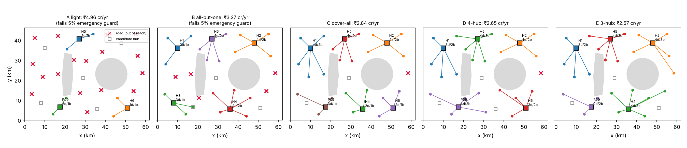
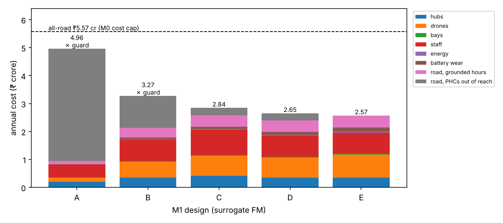

## M5 — Discrete-event simulator

**Erlang C check** (`results/m5_mmc_check.csv`). The brief's reduction is one hub, exponential drone time, no wind and no outage. The simulator also turns off batteries, the road rule and the reserve, and uses one class. The drone dispatch and queue code is the same as in the full model. The mean drone time is 36.7 min (M4's mean at H2). Each case uses 150,000 orders (450,000 at ρ = 0.9). The first 2 % are discarded, and the CI comes from 20 batch means.

| c | ρ | Wq Erlang C (min) | Wq simulated (min) | 95 % CI | Rel. error | P(wait) C / sim |
|---|---|---|---|---|---|---|
| 1 | 0.5 | 36.65 | 36.72 | ±1.32 | +0.2 % | 0.500 / 0.499 |
| 1 | 0.7 | 85.52 | 84.52 | ±3.29 | −1.2 % | 0.700 / 0.698 |
| 2 | 0.5 | 12.22 | 12.13 | ±0.41 | −0.7 % | 0.333 / 0.334 |
| 2 | 0.7 | 35.21 | 36.90 | ±2.05 | +4.8 % | 0.576 / 0.588 |
| 2 | 0.9 | 156.25 | 154.40 | ±12.48 | −1.2 % | 0.853 / 0.856 |
| 3 | 0.5 | 5.79 | 5.83 | ±0.29 | +0.7 % | 0.237 / 0.240 |
| 3 | 0.7 | 20.05 | 20.12 | ±1.16 | +0.3 % | 0.492 / 0.493 |
| 3 | 0.9 | 99.82 | 105.58 | ±6.77 | +5.8 % | 0.817 / 0.825 |

All 8 formula values lie inside the simulator's 95 % CI. The largest errors are at high ρ, where waits are long and strongly correlated. An earlier run with 60,000 orders missed the CI at c = 1, ρ = 0.5 by 0.5 min (−5.6 %, CI ±1.5). That is the about 1-in-20 miss a 95 % CI allows, so the run length was raised, not the seed changed.

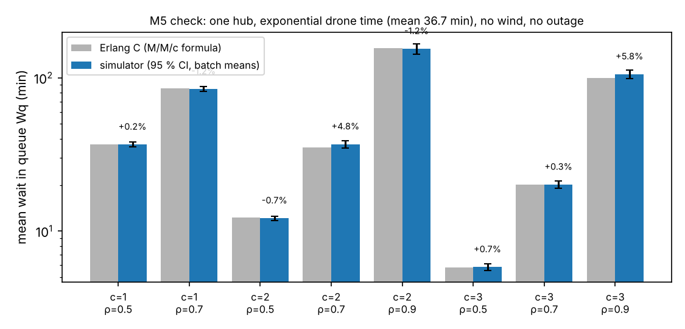

**How many days** (`results/m5_days_ci.csv`, `figures/m5_s45_days.png`).
- Days are drawn at random from the 365 wind days, each with its own demand stream.
- A 30-day pilot gave a day-to-day SD of 0.085, which predicts 34 days.
- The rule n = ⌈(t₀.₉₇₅·s/0.03)²⌉ was re-applied after each step: 30 → 34 → 39 → 42 → 60 days. The SD grew as monsoon days entered the sample. At 60 days, D's half-width was ±0.027.
- The same days are used for every configuration (common random numbers). E's CI was ±0.033 at 60 days, so all configurations were extended to 73 days. Every CI is then ≤ ±0.028.
- A day, not a long run, is the unit because the brief asks for "a day of operations" and the day has a hard 24:00 cut. Days are independent, so the t-interval on daily S45 is valid without batching.

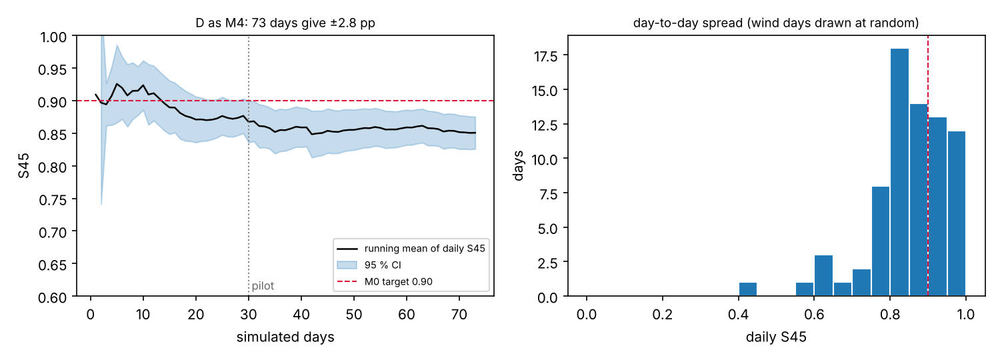

**Event-logic checks** (`results/m5_hand_check.csv`, `results/m5_rule_checks.csv`).
- *Hand-timed sortie:* design D, 10 km, calm air, one drone, no spare pack. The by-hand and simulator values agree to < 1e-9: delivery 14.01 min, energy 354.8 Wh, grid 394.3 Wh, drone busy 45.79 min including a 15.77 min wait for its own pack.
- *Rule checks (9/9 pass):*
  - The reserve holds the last drone from routine work, and an emergency gets it at once.
  - There were 0 take-offs in gust-grounded hours, over 1,582 take-offs on 26 days with grounding.
  - In the outage, at most 2 bays charge (4 before 14:00), and genset energy is ≤ 3 kW × 3 h.
  - Every order ends delivered, by road or by hand-over.
  - The same day and seed give the same result.

**Results on 73 days** (`results/m5_kpis.csv`, `results/m5_road_causes.csv`, `figures/m5_results.png`):

| Configuration | S45 (95 % CI) | P95 em. (min) | Util. | Road, all / em. | kWh/day grid + genset |
|---|---|---|---|---|---|
| D as M4 (8 drones, 4 bays, 0 spares) | 0.851 ± 0.025 | 150 | 0.46 | 45 % / 14.5 % | 42 + 3.9 |
| C as M4 | 0.814 ± 0.023 | 150 | 0.45 | 42 % / 17.8 % | 36 + 3.3 |
| E as M4 | 0.880 ± 0.028 | 150 | 0.50 | 48 % / 11.8 % | 62 + 5.5 |
| D + 1 spare pack per drone | 0.882 ± 0.026 | 150 | 0.41 | 26 % / 11.5 % | 58 + 5.7 |
| D, unlimited fleet (wind ceiling) | 0.896 ± 0.025 | 150 | 0.09 | 7 % / 10.3 % | 73 + 10.1 |

- **Why emergencies miss** (D as M4): 3.6 % gust grounding, 6.8 % out of range in that hour's headwind, 4.1 % no drone or charged pack, 0.3 % flown but late.
- **Ceiling.** With an unlimited fleet over all 365 days (`results/m5_wind_ceiling_year.csv`), S45 is 0.88 for C, 0.88 for D and 0.89 for E. Wind alone keeps every M4 network below the 0.90 target.
- **P95 = 150 min** (30 min wait + 120 min road) in every case, because more than 5 % of emergencies go by road. P95 only moves once the road share of emergencies falls below 5 %.
- **The binding resource is not drone time**, since utilisation is only 0.46 against M4's 70 % cap:
  - with no spares, a drone waits for its own pack (H2 drones wait 814 min a day in total);
  - the 25 % reserve idles a drone at three hubs;
  - routine orders to far PHCs wait out windy hours, so 45 % of all orders go by road at 24:00.

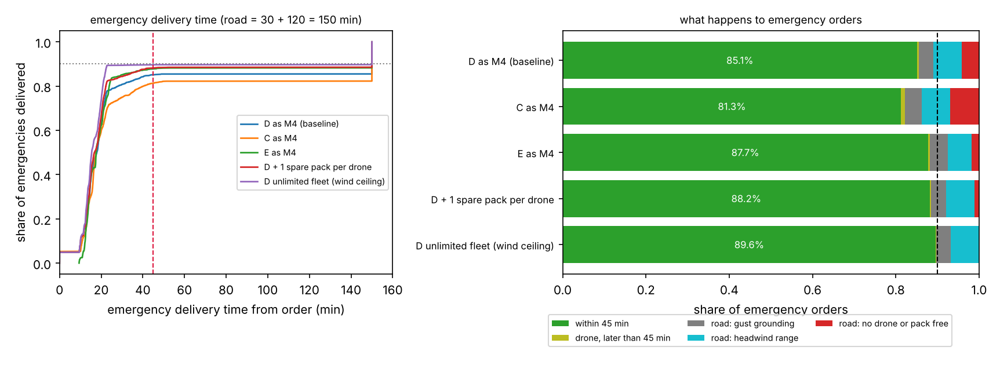

**Live view.** `figures/m5_live_day.gif` animates day 164, a Wednesday with gusts grounding 14–17 h during the grid outage. It shows every drone on its path around the no-fly zones, the queues at each hub, idle drones, drones waiting for a pack, bays charging and spare packs. The title shows the clock, wind, grounding, outage and running S45. A still is in `figures/m5_live_day_still.png`.

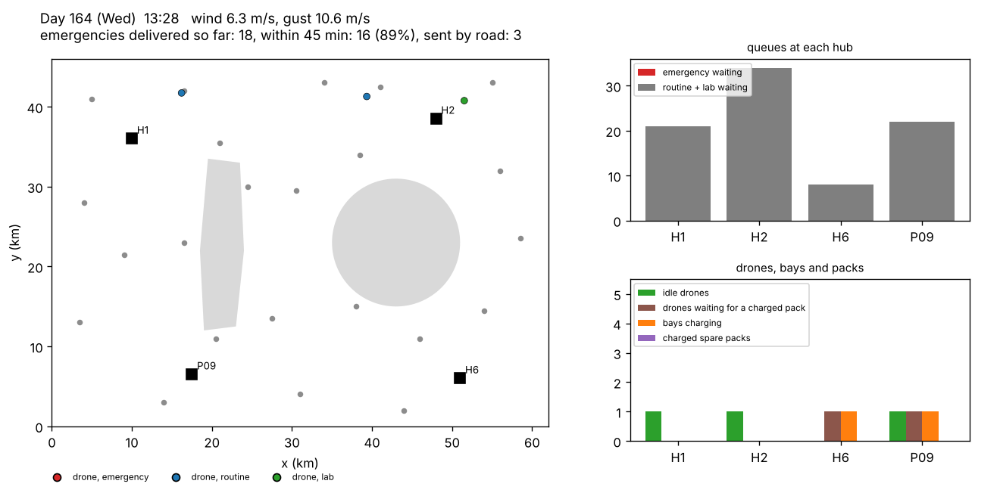

## M6 — Simulation-based multi-objective optimisation

Search: NSGA-II, one run per design (C, D, E), population 32 × 40 generations, every candidate simulated on M5's 73 (wind day, seed) pairs (common random numbers). 8,546 configurations were simulated in 41 min on 4 cores. The merged front has 178 points (`results/m6_front.csv`), and every simulated configuration is in `results/m6_archive.csv`. Convergence of each run is in `figures/m6_convergence.png` and `results/m6_convergence.csv`.

**1. Engine check on ZDT1** (`results/m6_zdt1_check.csv`). 30 variables, population 100 × 250 generations. Mean gap to the true front f₂ = 1 − √f₁ is **0.0024**, and the front spans f₁ 0–1. The first run used the usual SBX η = 15, mutation η = 20 and stalled at a gap of 0.21. η = 5 / 10 converges and is used for M6.

**2. Brief's check: weighted sum vs NSGA-II on a two-objective slice** (`results/m6_ws_slice.csv`, `results/m6_slice_front.csv`, `figures/m6_ws_slice.png`).
- Slice: design D (the M4 choice), objectives cost and S45.
- NSGA-II front: the non-dominated (cost, S45) points among every design-D configuration the 3-objective run and a dedicated 2-objective run (40 × 60) simulated, frozen before any weighted-sum run.
- Weighted sum: w·Ĉ + (1−w)·(1−Ŝ45) for w = 0.1…0.9, each solved by the same GA with one objective (16 × 12).

| w (cost) | cost (₹ cr) | S45 | On or behind the front? | Ahead by (pp of S45) |
|---|---|---|---|---|
| 0.1 | 2.234 | 0.896 | yes | – |
| 0.2 | 2.219 | 0.896 | yes | – |
| 0.3 | 2.253 | 0.896 | yes | – |
| 0.4 | 2.218 | 0.896 | yes | – |
| 0.5 | 2.204 | 0.896 | yes | – |
| 0.6 | 2.206 | 0.896 | yes | – |
| 0.7 | 2.135 | 0.885 | yes | – |
| 0.8 | 2.165 | 0.891 | **no** | 0.035 |
| 0.9 | 2.159 | 0.876 | yes | – |

- **8 of 9 are on or behind the front.** The w = 0.8 point is ahead by 0.035 pp of S45 (0.8915 vs 0.8911 at the same cost).
- The smallest step S45 can take on the 73 days is one emergency on one day: 1 / (emergencies that day × 73) = 0.034 pp on the busiest day and 0.049 pp on an average one. The lead is one emergency order, so the two points are tied at the resolution of the simulator.
- **The first run (25 generations, 2-objective slice 32 × 25) failed 2 of 9**, by 0.07 and 0.18 pp. It was fixed by running NSGA-II longer, not by seeding it with the weighted-sum answers. Seeding would make the check circular.
- Six of the nine weights land on just two S45 levels (0.8956 and 0.8960) and leave gaps along the front. That is the usual weakness of a weighted sum, and the reason NSGA-II is the main method.

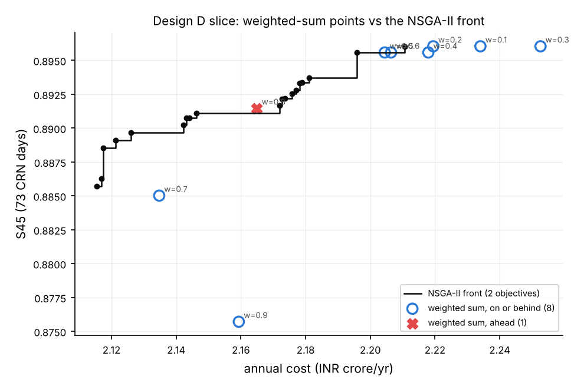

**Weighted-sum result on the full problem** (`results/m6_ws_3obj.csv`). Equal weights on the three objectives, each scaled to [0, 1] over the front, solved per design. The best is design E (n 4-4-4, spares 4-5-8, bays 6-8-3, one reserve per hub): ₹2.23 cr/yr, S45 0.901, road 7.6 %. It is **on or behind the NSGA-II front**, and it sits next to the knee (₹2.20 cr, 0.901, 8.7 %). On 365 days the two are equal on S45 (0.889), and the weighted sum costs ₹3.8 lakh/yr more for 1 pp less road share. Both rules point to the same design and region.

**3. Re-simulation off the search days** (`results/m6_resim_365.csv`, `figures/m6_resim.png`). No surrogate is used, so the brief's "re-simulated front points agree with surrogate predictions within the stated error" becomes: do front points found on 73 days hold up on all 365 days with fresh demand seeds? Fifteen front points, the four M4/M5 baselines and the weighted-sum result were re-simulated.

| Point | Cost 73 d / 365 d (₹ cr) | S45 73 d | S45 365 d | Road share 365 d | P95 |
|---|---|---|---|---|---|
| Cheapest (D n2-3-2-3, s4-3-2-4, b2-3-2-2, k0) | 2.12 / 2.19 | 0.885 ± 0.026 | 0.864 ± 0.015 | 9.7 % | 150 |
| Cheapest E (n4-3-3, s8-4-3, b3-2-3, k0) | 2.13 / 2.17 | 0.887 ± 0.028 | 0.875 ± 0.015 | 8.9 % | 150 |
| E n4-3-4, s5-5-4, b4-2-3, k0 | 2.15 / 2.20 | 0.891 ± 0.028 | 0.880 ± 0.015 | 8.2 % | 150 |
| **Knee: E n4-3-4, s4-4-6, b3-2-4, k1-1-1** | **2.20 / 2.25** | **0.901 ± 0.028** | **0.889 ± 0.015** | **10.2 %** | 150 |
| Weighted sum, equal weights (E n4-4-4, s4-5-8, b6-8-3, k1) | 2.23 / 2.29 | 0.901 ± 0.027 | 0.889 ± 0.015 | 9.2 % | 150 |
| Highest S45 (E n5-4-4, s4-6-5, b3-2-2, k1) | 2.40 / 2.45 | 0.902 ± 0.027 | 0.889 ± 0.015 | 8.8 % | 150 |
| D as M4 (M5 baseline) | 3.28 / 3.34 | 0.851 ± 0.025 | 0.823 ± 0.014 | 45.8 % | 150 |
| D + 1 spare per drone (M5) | 2.62 / 2.67 | 0.882 ± 0.026 | 0.862 ± 0.014 | 27.1 % | 150 |

- **20 of 20 agree within the combined 95 % CI.** The Spearman rank correlation between the 73-day and 365-day S45 is 0.82.
- **There is a bias.** Every point is lower on 365 days, by 1.7 pp on average: D points by 1.9–2.8 pp, E points by 0.8–1.3 pp. The 73 random days are milder than the year for D's long H2 legs, which is the same effect M5 found at the wind ceiling (0.896 vs 0.88). The search also picks points that did well on those days.
- **Consequence:** on 365 days no configuration reaches S45 = 0.90. Final numbers are quoted on 365 days. On the year, E points beat D points on S45, which the 73 days had blurred.

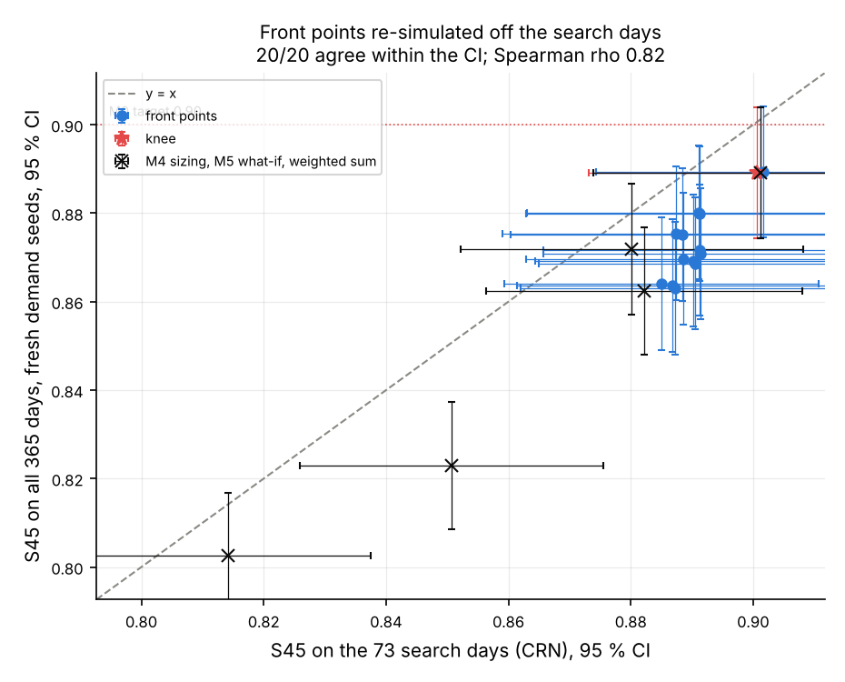

**4. Cost hand check** (`results/m6_cost_hand_check.csv`). For "D as M4", M6's hubs (₹27.72 lakh), drones (₹31.97 lakh), bays (₹0.95 lakh) and operators (₹60.48 lakh) match M4's cost breakdown to < 1e-6. The simulated terms differ from M4 on purpose: M4 charged road trips only for emergencies in grounded hours, while the simulator also sends routine and lab orders by road when packs and bays run short.

**Front** (`figures/m6_pareto.png`).
- (a) Cost vs S45, with the knee and the weighted-sum result.
- (b) Cost vs road share.
- (c) P95 against the share of emergencies sent by road. P95 = 150 min at every front point, because 10–11 % of emergencies still go by road (wind). P95 can fall below 150 min only when that share drops below 5 %.

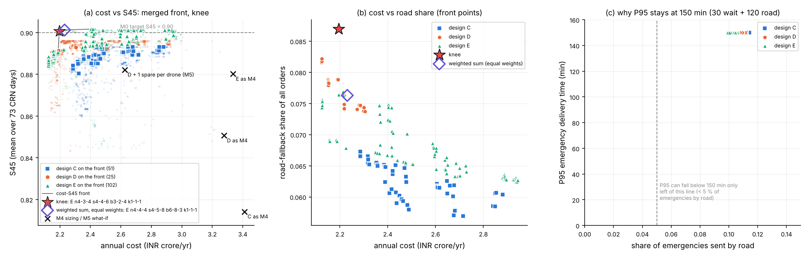

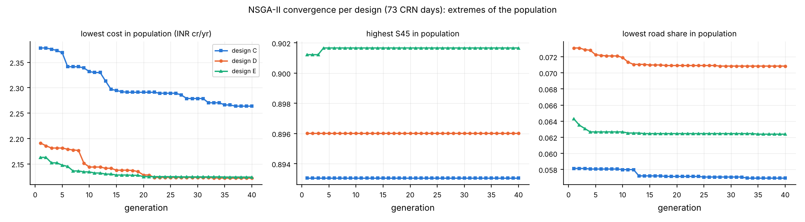

**Convergence.** The highest S45 and lowest road share settle by generation 15 for all three designs, and the lowest cost settles by generation 25 for D and E. Design C's cheapest point is still falling slowly at generation 40 (₹2.26 cr). C is dominated by D and E everywhere on the cost–S45 view, so this does not change the knee or the top candidates.
